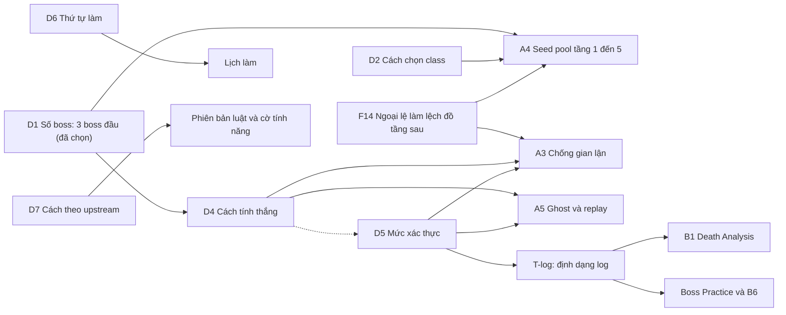

# Quyết định cần chốt — spd-ranked

Tài liệu này thay cho phần "Nhóm 2" cũ của [`TASKS.md`](TASKS.md). Mục đích: biết quyết định nào phải chốt **trước khi bắt tay làm**, quyết định nào có thể hỏi **khi đang code**, và chúng ảnh hưởng nhau thế nào.

Trạng thái (21/10): user đã đính chính luật Duel (mục 2), nên câu D2 và D3 cũ đã rút, D2 mới hỏi cách chọn class. **D1 đã chọn: 3 boss đầu.** Còn 5 câu chờ chọn (mục 4). Chọn xong sẽ chạy Agent kiểm tra khả thi lâu dài; kết quả ghi ở mục 7.

---

## 1. Đã kiểm chứng trong code SPD v4.0.2

Những điều dưới đây đọc trực tiếp từ source, không phải suy đoán. Chúng là cơ sở cho các câu hỏi.

| # | Phát hiện | Nguồn | Hệ quả |
|---|---|---|---|
| F1 | Boss ở tầng 5, 10, 15, 20, 25 (Goo, Tengu, DM-300, Dwarf King, Yog); tầng 26 là `LastLevel` | `Dungeon.newLevel`, `Dungeon.bossLevel` | Chuỗi boss cố định theo tầng |
| F2 | Seed của một tầng chỉ phụ thuộc seed gốc + số tầng, không phụ thuộc tầng trước | `Dungeon.seedForDepth` | Sinh thẳng tầng boss được về mặt seed. Cách "thả" người chơi vào tầng boss (InterlevelScene) **chưa kiểm chứng** → việc T-start |
| F3 | Tầng boss là đấu trường dựng sẵn; seed chỉ đổi vị trí, trang trí, hazard | `levels/*BossLevel.java` | Với chế độ Boss Practice (vào thẳng boss bằng kit) seed gần như không quan trọng; seed pool chỉ có ý nghĩa ở Ranked đua từ tầng 1 |
| F4 | Có trạng thái tích lũy qua các tầng: `LimitedDrops` (bình sức mạnh, scroll nâng cấp...), bộ bài `Generator`, quest | `Dungeon.LimitedDrops` | Bắt đầu từ tầng boss thì trạng thái này không có, kit phải cấp đủ |
| F5 | Subclass mở bằng `TengusMask` (Tengu), armor ability bằng `KingsCrown` (Dwarf King) | `items/TengusMask.java`, `items/KingsCrown.java` | Số boss mỗi trận quyết định build cần những phần nào |
| F6 | 6 class (Warrior, Mage, Rogue, Huntress, Duelist, Cleric), mỗi class 2 subclass | `HeroClass` | Số kit phải cân bằng |
| F7 | RNG là một stack; gameplay mặc định dùng generator gốc **không seed**; hiệu ứng/sprite (38 file) gọi cùng `Random.Float()` | `SPD-classes/.../Random.java`, `effects/`, `sprites/` | Chiến đấu không tái tạo được chỉ từ seed. Tính năng chỉ hiển thị không được gọi `Random` |
| F8 | Actor chọn lượt từ `HashSet`; hòa thời gian và `actPriority` thì phụ thuộc thứ tự duyệt set. `Actor.java` không override `hashCode` | `actors/Actor.java:152`, `:250-270` | Mô phỏng lại tất định cần sửa nhiều chỗ (phương án C của D5) |
| F9 | Không có JUnit, không có thư mục `test` | `build.gradle`, `core/src` | Khung test dựng từ đầu; libGDX headless dùng được đến đâu **chưa biết** (T0.4) |
| F10 | Đã có sẵn: HP bar kẻ địch (chỉ hiện khi mất máu), ghi chú gắn item (`Notes.CustomRecord`), `Catalog/Bestiary.isSeen`, daily seed, `QuickSlot.SIZE = 6` (static), phím zoom | `ui/CharHealthIndicator`, `journal/Notes`, `Dungeon.daily` | Nhóm C nhỏ hơn dự kiến |
| F11 | Hunger: HUNGRY 300, STARVING 450, +1/lượt; đổi theo `Shadows` (x1,5), `SaltCube`; tạm dừng khi `WellFed`, tầng bị khóa | `actors/buffs/Hunger.java` | Food Forecast tính chính xác được từ buff, không cần ước lượng |
| F12 | Bản debug Android có `applicationIdSuffix ".indev"` | `android/build.gradle` | Cài song song với SPD gốc để thử, chưa cần đổi tên ngay |
| F14 | Sinh tầng và "bộ bài" của `Generator`: lần rút thứ n của một loại item cố định theo seed riêng của loại đó (code ghi rõ mục đích: drop nhất quán dù xảy ra lúc nào). **Loot quái** (`Mob.createLoot`) dùng `randomUsingDefaults` hoặc tạo trực tiếp, không đụng bộ bài. **Hạt từ cỏ** (`HighGrass:143`) rút bộ bài SEED, nhưng sinh tầng không bao giờ rút bộ bài SEED (`Generator.random()` chuyển SEED sang `randomUsingDefaults`, `PlantsRoom` cũng dùng defaults). Bộ đếm `LimitedDrops` của sinh tầng chỉ tăng trong `Level.create` và `SpecialRoom` | `items/Generator.java:271-273,684-691,712-727`, `actors/mobs/Mob.java:1139-1159`, `levels/features/HighGrass.java:143`, `levels/Level.java:226-258` | **Đồ có sẵn ở các tầng sau không đổi vì loot quái hay giẫm cỏ**; hành vi chơi chỉ đổi vị trí và thời điểm đồ phát sinh khi chơi. Kết luận từ đọc code, **chưa chạy thử**. Ngoại lệ hẹp cần theo dõi: (1) rút bộ bài dùng chung với sinh tầng lúc chơi: Ring of Wealth rút ARTIFACT (`RingOfWealth.java:291`), Scroll of Transmutation đổi artifact (`:298`); (2) nội dung tầng phụ thuộc inventory, ví dụ trinket Exotic Crystals đổi tỉ lệ bình/scroll exotic (`ExoticCrystals.java:48`); (3) dữ liệu cục bộ: `Bones.get()` thêm item vào tầng (`RegularLevel.java:493`) |
| F13 | Thông báo cập nhật và news feed trỏ về upstream | `services/updates`, `services/news`, `docs/recommended-changes.md` | Phải tắt/đổi trước khi phát hành |

## 2. Luật đã chốt từ user (21/10) và giả định còn lại

**Đã chốt:**
- **Ranked Duel**: hai client đua song song từ tầng 1 lên các boss ở tầng 5, 10, 15 (D1 chọn 3 boss đầu). Ai hạ boss trước thì thắng (cách tính chi tiết ở D4).
- **Seed pool**: dùng công cụ tạo, chọn seed có đồ tốt ở tầng 1 đến 5 để người chơi sống sót giai đoạn đầu.
- **Boss Practice**: vào thẳng boss bằng kit là **một chế độ khác**, chơi đơn để luyện tay. Không thuộc Ranked.

**Giả định còn lại (báo lại nếu sai):**
- Ranked giai đoạn đầu chỉ có 1v1.
- Server do user tự vận hành (OPPO A53), chưa dùng dịch vụ cloud trả phí.
- Repo cũ nằm trên máy user nên phiên cloud này **không đọc được**. Mọi thông tin về thiết kế cũ lấy từ `ROADMAP.md`, chưa đối chiếu với `TECHNICAL_DESIGN.md`.

## 3. Bản đồ phụ thuộc

Đọc bản đồ theo ba nhóm:

**Nhóm I, luật Duel (D1, D2, D4).** Trận là một lần chơi đầy đủ từ tầng 1 nên mọi cơ chế thường (quest, shop, đói, nhận dạng item) đều tham gia. D1 cho biết trận kéo dài tới tầng 15. D2 (chọn class) quyết định seed pool chấm chung hay theo class, và ảnh hưởng công bằng của bảng xếp hạng. D4 quyết định server phải đo và kiểm tra cái gì.

**Nhóm II, tin cậy và dữ liệu (D5, F14).** D5 đổi **định dạng event log**, nền của Death Analysis (B1), Boss Practice/B6, replay (A5) và chống gian lận (A3). Vì trận dài và đầy đủ, log lớn hơn nhiều so với bản boss-only; phải chốt D5 trước khi cố định định dạng log. F14 đã được đọc lại: loot quái và giẫm cỏ **không** đổi đồ có sẵn ở tầng sau, nên seed pool chấm bằng cách sinh tầng tuần tự về cơ bản đúng. Còn lại vài ngoại lệ hẹp (Ring of Wealth, Transmutation, trinket Exotic Crystals, Bones) cần chuẩn hóa trong Ranked và một spike chạy thật để xác nhận.

**Nhóm III, quy trình (D6, D7).** D6 quyết định thứ tự, nhưng Ranked chỉ nên bắt đầu khi D4, D5 và F14 đã rõ. D7 quyết định luật có ổn định trong một mùa không.

Boss Practice là chế độ riêng, tận dụng chung cơ chế "dựng hero với kit rồi vào thẳng tầng boss" và event log. Kit, danh sách boss, class/build của chế độ này hỏi khi bắt đầu làm (L17).

## 4. Hỏi ngay (7 câu)

Tiêu chí "hỏi ngay": câu trả lời làm thay đổi nền móng (bước 1 đến 3 của thứ tự làm), hoặc làm đổi hình dạng của từ 3 task trở lên, hoặc rất tốn kém để đổi sau.

| ID | Câu hỏi | Chặn / ảnh hưởng | Đề xuất | Kết quả |
|---|---|---|---|---|
| D1 | Số boss mỗi trận Duel | độ dài trận, D4 | A: 3 boss đầu | **đã chọn: 3 boss đầu** |
| D2 | Cách chọn class trong Duel đua | A4, công bằng xếp hạng | A: tự chọn class | chờ (thẻ 2/6) |
| D3 | (đã rút) kit và build giữa các boss | chuyển sang Boss Practice, L17 | | rút do luật mới |
| D4 | Điều kiện thắng | A1, A3, A5, ghost | A: ai hạ boss cuối trước (giờ thực) | chờ (thẻ 4/7) |
| D5 | Mức xác thực kết quả | T-log, A3, A5, B1, B6, sửa code gốc | B: log có chữ ký + server kiểm quy tắc | chờ (thẻ 5/7) |
| D6 | Thứ tự ưu tiên | toàn bộ lịch | A: nền móng, QoL nhỏ, rồi Ranked | chờ (thẻ 6/7) |
| D7 | Cách theo upstream | quy trình merge, ổn định mùa | A: theo bản phát hành (tag) | chờ (thẻ 7/7) |

Chi tiết ba lựa chọn của từng câu nằm trong các thẻ quyết định ở thread; bảng này ghi kết quả khi user chọn.

## 5. Hỏi khi đang code

Các câu này chỉ ảnh hưởng một task, hoặc cần thấy tính năng chạy rồi mới chọn được. Mỗi câu có mặc định để không dừng việc.

| ID | Câu hỏi | Hỏi khi | Mặc định nếu không trả lời | Task |
|---|---|---|---|---|
| L1 | Hosting: chỉ OPPO A53, hay thêm VPS dự phòng | trước khi dựng khung server | server nhẹ, chạy được cả hai, chưa mua gì | A1, A7 |
| L2 | Tài khoản: ID thiết bị hay email/Google; telemetry bắt buộc hay chọn tham gia | thiết kế A1 | khóa thiết bị + tên hiển thị; telemetry chỉ trong Ranked và nói rõ | A1, A5 |
| L3 | Android và desktop chung một bảng xếp hạng hay tách | thiết kế rating (liên quan D4) | tách theo nền tảng nhập liệu cho đến khi có số liệu | A1 |
| L4 | Rating: thuật toán, độ dài mùa, trận xếp hạng đầu | thiết kế rating | rating kiểu Elo/Glicko đơn giản, mùa 8 tuần | A1 |
| L5 | Tính năng Learning nào bật trong Ranked | trước khi bật Ranked đầu tiên | whitelist do server gửi; bản đầu chỉ tính năng không lộ thông tin thêm | T0.2, B* |
| L6 | Chính sách ngắt kết nối, giới hạn thời gian trận, hòa, strike, vote reroll, tranh chấp | thiết kế A1 (đối chiếu repo cũ) | giữ luật cũ nếu đọc được, nếu không dùng bộ luật tối giản | A1 |
| L7 | Tên game, `appPackageName`, icon, thông báo cập nhật, news, nút ủng hộ | trước bản phát hành đầu | dùng `.indev` để thử, chưa phát hành | F12, F13 |
| L8 | Ngôn ngữ cho chuỗi mới: chỉ EN, hay EN + VI | tính năng UI đầu tiên (B3) | EN + VI, ngôn ngữ khác rơi về EN | B* |
| L9 | Known Item Recognition: chỉ item đã định danh hay cả đã thử dùng; ký hiệu cho item chưa biết | B3 | chỉ đã định danh, có ký hiệu rõ cho item chưa biết | B3 |
| L10 | Food Forecast: chỉ số lượt hay thêm dự báo theo tầng | B5 | chỉ số lượt + thức ăn đang có | B5 |
| L11 | Run Value: luật cố định hay thích ứng theo build | B4 | luật cố định, bảng dữ liệu chỉnh được | B4 |
| L12 | Nội dung và tông Death Analysis: liệt kê lựa chọn bỏ lỡ theo luật nào | B1 | chỉ nêu dữ kiện, không phán đoán | B1 |
| L13 | Training: khôi phục từ đầu encounter hay từ log; có tính vào hồ sơ không | B6 (phụ thuộc D5) | đầu encounter, không tính vào hồ sơ | B6 |
| L14 | Combat Probability: dạng % hay Cao/Vừa/Thấp; có cho Ranked không | C6 | % , chỉ Solo | C6 |
| L15 | Mục C nào đáng làm, và chế độ ngoài 1v1 (2v2, Weekly League, Daily) | sau khi có báo cáo khảo sát C | chưa làm gì cho đến khi 1v1 ổn định | C* |
| L16 | Có hỗ trợ iOS không | trước khi dựng CI phát hành | không | CI |
| L17 | Boss Practice: danh sách boss, kit và build mỗi class, kit reset hay mang theo, có cho đấu đôi bằng kit không | bắt đầu làm Boss Practice | chơi đơn; kit cố định theo class và boss, reset mỗi boss; chưa làm đấu đôi | B6, Boss Practice |
| L18 | Tiêu chí "đồ tốt tầng 1 đến 5" của seed pool, và trần chất lượng để hạn chế may rủi | bắt đầu A4 (sau spike F14) | đảm bảo có đồ phòng thủ dùng được và hồi máu hoặc thoát thân trong tầng 1 đến 5, có trần trên | A4 |

## 6. Tự quyết (kỹ thuật và tối ưu)

Danh sách đầy đủ ở [`TASKS.md`](TASKS.md) mục "Nhóm 3". Bổ sung từ phát hiện ở mục 1:

- **Luật rule-set là dữ liệu**: số boss, kit, có mang theo hay không, whitelist tính năng nằm trong một file cấu hình có số phiên bản, không hard-code. Nhờ vậy chọn sai ở D1/D2 vẫn đổi được bằng dữ liệu thay vì viết lại.
- **Tính năng chỉ hiển thị không gọi `Random`** (F7), có test kiểm tra trạng thái trước/sau khi bật tính năng.
- **Log luôn ghi đủ để nâng cấp xác thực sau** (kết quả mỗi lần tung RNG, thao tác, mốc thời gian), kể cả khi D5 chọn mức nhẹ hơn.
- **Spike khung test trước tiên** (F9): thử dựng test logic thuần (công thức Food Forecast, bảng Run Value, mã hóa log) và một test headless khởi tạo `Dungeon`; kết quả quyết định mức test tích hợp khả thi.
- **Spike "cùng seed, cùng đồ"** (F14, T-seed): chạy hai kịch bản chơi khác nhau (giẫm cỏ, giết quái có loot, đi đường khác) trên cùng seed và so sánh **danh sách đồ có sẵn** từng tầng 1 đến 15, kể cả vị trí. Kỳ vọng từ đọc code: danh sách giống nhau. Sau đó thử riêng các ngoại lệ ở F14 (Ring of Wealth, Transmutation, Exotic Crystals, Bones). Ranked cần chế độ "sạch": tắt Bones, chuẩn hóa meta (mở khóa class, trang hướng dẫn), và quyết định cách xử lý ba ngoại lệ còn lại (chặn, hoặc tách bộ bài lúc chơi khỏi sinh tầng). Làm trước A4.
- **Spike "thả vào tầng boss"** (F2, F4) cho Boss Practice: đường vào tầng boss với hero dựng sẵn và các trạng thái tích lũy.
- Dùng `.indev` khi thử trên điện thoại (F12).

## 7. Kết quả kiểm tra khả thi lâu dài

Chưa chạy. Sẽ chạy Agent sau khi user chọn xong 7 câu, kiểm tra: mâu thuẫn giữa các lựa chọn, đối chiếu với các phát hiện ở mục 1, rủi ro khi mở rộng (5 boss, thêm chế độ, nhiều mùa), và những lựa chọn nên đổi.
